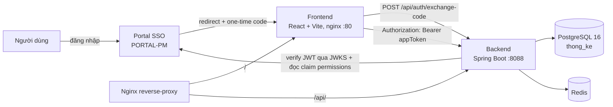

# Architecture — Hiện trạng thật (cập nhật 2026-08-29, lượt 2)

Ghi lại từ code thật + verify sống qua preview Docker thật (không suy
đoán). Xem `docs/CODEBASE_MAP.md` cho bản đồ thư mục, `docs/TECHNICAL_DEBT.md`
cho danh sách phát hiện/đã sửa.

**Thay đổi so với lượt onboarding 1**: đã gỡ hoàn toàn phụ thuộc MongoDB
(dự án nay 100% độc lập trên PostgreSQL), đã bật lại xác thực/phân quyền
JWT + Portal SSO (trước đây bị tắt hoàn toàn), đã dựng + verify preview
sống thật.

## 1. Tổng quan hệ thống



Dự án ĐỘC LẬP — không còn kết nối MongoDB/hệ "Lệnh SX" cũ nào. Sẽ tích hợp
lại với DIEU-PHOI-MM trong tương lai qua cơ chế riêng (chưa thiết kế),
không liên quan TK-HATU.

## 2. Backend — Spring Boot 4.0.7 / Java 21

- **Layered**: controller → service → repository (Spring Data JPA) → Postgres, dùng MapStruct cho DTO mapping, Lombok cho boilerplate.
- **API docs**: springdoc-openapi tại `/v3/api-docs`, Swagger UI tại `/swagger-ui.html` (public endpoint).
- **Health**: `/actuator/health` (public), Dockerfile có `curl` nên healthcheck container hoạt động đúng — port healthcheck trong `backend/docker-compose.yaml` đã sửa (trước map nhầm `8099:8090`, nay `8099:8088`, xem TECHNICAL_DEBT mục 4 ĐÃ SỬA).
- **Import/Export Excel**: Apache POI, cho báo cáo Vận tải + Khai thác (import số liệu từ file mẫu, export báo cáo).

## 3. Xác thực & phân quyền — ĐÃ BẬT LẠI, verify sống thật (2026-08-29)

Luồng đầy đủ, TẤT CẢ đang hoạt động (không còn khoảng cách thiết kế↔thực tế
như lượt onboarding 1):

1. Người dùng đăng nhập ở Portal (app khác, PORTAL-PM) → Portal redirect về THONGKE-CAOSON kèm 1 `code` dùng 1 lần.
2. Frontend gọi `POST /api/auth/exchange-code` → `OtcStore` đổi code lấy `appToken` (JWT) + `refreshToken`.
3. Mỗi request sau đó gắn `Authorization: Bearer <appToken>`.
4. Spring OAuth2 Resource Server verify JWT bằng public key lấy từ Portal (`jwk-set-uri`).
5. `AppTokenFilter` đọc claim `permissions` (map `resource → {c,r,u,d,a}`) trong JWT, dựng `AppUserDetails`.
6. `PermissionFilter` chặn theo annotation `@RequirePermission(resource=...)` trên controller/method, cho qua nếu có `@PublicApi`.
7. `POST /api/auth/refresh` gọi ngược Portal (`{portal.internal-url}/api/auth/refresh`) để lấy `appToken` mới khi hết hạn.

`SecurityConfig.java` hiện tại:

```java
.oauth2ResourceServer(oauth2 -> oauth2.jwt(Customizer.withDefaults()))
.authorizeHttpRequests(authorize -> authorize
        .requestMatchers(PUBLIC_ENDPOINT).permitAll()   // /actuator/health, /v3/api-docs/**, /swagger-ui/**, /api/auth/**
        .anyRequest().authenticated()
)
.addFilterAfter(appTokenFilter, BearerTokenAuthenticationFilter.class)
.addFilterAfter(permissionFilter, AppTokenFilter.class)
```

**Verify THẬT qua preview sống** (`http://thongke-caoson.preview.localhost:8080/`):
- `/actuator/health`, `/swagger-ui/index.html` → `200` (public).
- `/api/auth/exchange-code` (code giả) → `500` (lỗi nghiệp vụ, KHÔNG bị chặn bởi security — đúng, endpoint đăng nhập phải public).
- `/api/users` không token → `401`. Với token giả (`Bearer garbage...`) → `401` (JWT decoder thật sự chạy).
- `jwk-set-uri` trỏ JWKS thật của PORTAL-PM (qua bridge network, xem mục 7) → `200`, trả bộ khoá RSA thật.

Frontend có `RoleGuard`/`ProtectedRoute` chặn theo role ở tầng UI
(`ROLE_TRANSPORT`...) — nay khớp đúng với backend (backend cũng thực sự
kiểm tra), không còn là "giao diện giả vờ có phân quyền" như trước.

**Chưa verify**: vòng đăng nhập ĐẦY ĐỦ (Portal redirect thật → nhận code →
đổi token thật → gọi API nghiệp vụ bằng token thật) — cần THONGKE-CAOSON
được đăng ký như 1 Application trong PORTAL-PM (việc phía Portal, DB Portal
preview hiện đang rỗng, chưa có admin). Xem TECHNICAL_DEBT mục "Điều kiện
còn thiếu".

## 4. Module đối chiếu (Reconciliation) — mới nhất trong lịch sử Git

2 commit gần nhất của repo (trước onboarding) implement module này:
`ReconciliationController` + `ReconciliationDecision` (backend),
`ReconciliationPage`/`StandardTripReportPage` (frontend, có bảng so sánh +
dialog xác nhận tái sử dụng). Trước đây đối chiếu với dữ liệu đồng bộ từ
MongoDB — cơ chế đó đã gỡ, ý nghĩa/nguồn dữ liệu đối chiếu trong tương lai
cần thiết kế lại cùng lúc tích hợp DIEU-PHOI-MM. **Chưa đọc sâu logic
nghiệp vụ chi tiết hiện tại** (ngoài phạm vi các lượt vừa qua).

## 5. Frontend

- React 19 + Vite 8 + TypeScript, UI trộn **shadcn/ui (Radix primitives) VÀ
  MUI** (2 hệ thống component song song), cộng `@fortune-sheet/react` (bảng
  tính kiểu Excel) + `xlsx` (đọc/ghi Excel phía client) + `leaflet`/
  `react-leaflet` (bản đồ, khớp `Location`+`Coordinates` entity).
- State: Zustand (global) + TanStack Query (server state) + TanStack Table.
- Form/validate: React Hook Form + **cả Zod lẫn Yup** (2 thư viện validate song song).
- Build: `pnpm` (Dockerfile dùng pnpm ARG/ENV để bake `VITE_API_KONG_URL`/
  `VITE_PORTAL_URL` build-time vào bundle — mới thêm 2026-08-29 cho preview).
- Không có test nào (`package.json` không có script `test`).
- `AuthGate` (bọc toàn app) đọc `?code=` trên URL lúc tải trang để đổi
  token — KHÔNG tự động redirect sang Portal nếu thiếu (chỉ hiện màn "Xác
  thực thất bại" + nút thử lại). `SignInPage` (redirect sang
  `VITE_PORTAL_URL`) tồn tại nhưng không có route nào dùng tới — xem
  TECHNICAL_DEBT mục 6.

## 6. Hạ tầng / Triển khai

- **Preview local (factory)** — MỚI, verify sống 2026-08-29:
  `deployment/preview/preview-docker-compose.yaml` (postgres + redis +
  backend + frontend + reverse-proxy, service tự build từ source, không
  publish host port, join network `factory-preview` dùng chung, gateway
  route `http://thongke-caoson.preview.localhost:8080/`). Nginx riêng
  `reverse_proxy/nginx_preview.conf` (file mới, khác `nginx_staging.conf`).
- **Backend-only local dev**: `backend/docker-compose.yaml` (postgres +
  pgadmin + backend, port đã sửa) — dùng khi chạy frontend riêng qua `pnpm dev`.
- **Staging**: GitHub Actions (`deploy-staging.yml`, trigger PR → `main`) →
  `make staging` (build 3 image, push DockerHub) → SSH vào VPS
  (`STAGING_HOST`, credential trong GitHub Secrets, không hardcode) →
  `docker compose -f staging-docker-compose.yml up`. KHÔNG đụng trong lượt
  này (chỉ thêm preview local mới).
- **CORS staging**: `reverse_proxy/nginx_staging.conf` vẫn có
  `Access-Control-Allow-Origin: '*'` + `Access-Control-Allow-Credentials: true`
  cùng lúc (sai spec) — không sửa trong lượt này, chỉ ghi nhận (xem
  TECHNICAL_DEBT mục 10). `nginx_preview.conf` MỚI không lặp lại lỗi này
  (không set CORS header ở tầng nginx, để Spring xử lý).

## 7. Tích hợp Portal (JWKS) trong preview local — bridge network runtime

Portal SSO (PORTAL-PM) chạy như 1 project preview RIÊNG trong factory
(`docker-compose.local.yml` của chính nó — publish `localhost:18090`, entry
point thật qua Kong+reverse-proxy, KHÔNG qua alias `factory-preview`).
Để backend THONGKE-CAOSON gọi được JWKS/refresh thật của Portal mà không
sửa compose của PORTAL-PM, dùng `docker network connect` RUNTIME (không
phải cấu hình trong compose file nào):

```bash
docker network connect thongke-caoson-preview_portal-link \
  portal-pm-local-reverse-proxy-1 --alias portal-gateway
```

Sau đó backend gọi `http://portal-gateway:8888/...` — đã verify JWKS trả
`200` thật. Cần chạy lại lệnh này mỗi khi container reverse-proxy của
PORTAL-PM bị recreate (không persistent qua restart) — xem TECHNICAL_DEBT
mục "Điều kiện còn thiếu" #3.

## 8. Biến môi trường (cập nhật, đã bỏ toàn bộ biến liên quan Mongo)

| Biến | Vai trò | Có giá trị mặc định dev? |
|---|---|---|
| `SPRING_PROFILES_ACTIVE` | Chọn profile (`dev`/`prod`) | `dev` |
| `SPRING_DATASOURCE_URL/USERNAME/PASSWORD` | Kết nối Postgres | Dev: `localhost:5440` (chạy host) hoặc override qua compose (preview) |
| `REDIS_HOST/PORT/PASSWORD` | Kết nối Redis | Dev: `localhost:6379`/override qua compose (preview: `redis`) |
| `SPRING_SECURITY_OAUTH2_RESOURCESERVER_JWT_JWKSETURI` | Override `jwk-set-uri` qua env (Spring relaxed-binding: bỏ hẳn dấu `-`, không thay bằng `_`) | Dev hardcode `http://localhost:1188/...`, preview override `http://portal-gateway:8888/...` |
| `PORTAL_INTERNALURL` | Override `portal.internal-url` qua env (cùng quy tắc relaxed-binding) | Preview override `http://portal-gateway:8888` |
| `THONG_KE_PORT` | Cổng lắng nghe (prod) | Dev hardcode `8088` |
| `VITE_API_KONG_URL`, `VITE_PORTAL_URL` | Base URL API + URL Portal cho frontend (BUILD-TIME, bake vào bundle) | Preview: set qua build-arg trong `preview-docker-compose.yaml` |
| `POSTGRES_USER/PASSWORD/DB`, `PGADMIN_EMAIL/PASSWORD` | Container Postgres/pgAdmin local | Có default dev yếu |
