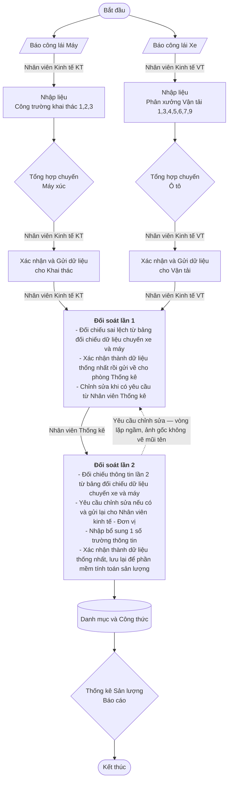

# Yêu cầu nghiệp vụ — Luồng công việc (workflow) thống kê sản lượng

Nguồn:

1. Sơ đồ workflow + đặc tả trường dữ liệu chủ dự án cung cấp trong phiên
   làm việc 2026-08-30.
2. **Tài liệu gốc `Module Thống kê sản lượng.docx`** (đề ngày 03.08.2026) —
   đã trích xuất nguyên văn vào `docs/_source/module-thong-ke-san-luong.txt`
   để phiên sau không phụ thuộc đường dẫn máy cá nhân.
3. Phần tính sản lượng (mục III của tài liệu gốc) tách riêng sang
   **`docs/REQUIREMENT_SANLUONG.md`** vì quá dài (danh mục + ~25 nhóm công
   thức).

> ⚠ **Cần chủ dự án xác nhận — tên tài liệu gốc:** tiêu đề trang đầu ghi
> *"MODULE THỐNG KÊ – **PHẦN MỀM ĐIỀU PHỐI MÁY MÓC THIẾT BỊ CAO SƠN**"*.
> Trong khi đó `CLAUDE.md` của dự án khẳng định THONGKE-CAOSON **độc lập**,
> chỉ "tích hợp với DIEU-PHOI-MM trong tương lai qua cơ chế riêng". Hai
> điều này có thể mâu thuẫn: hoặc module thống kê thuộc về sản phẩm Điều
> phối MMTB, hoặc tiêu đề chỉ là tên bộ tài liệu chung của khách hàng. Ảnh
> hưởng tới ranh giới hệ thống — **chưa tự kết luận**.

Đây là tài liệu **nghiệp vụ mong muốn
(TO-BE)** — KHÁC với `docs/REQUIREMENTS_AS_IS.md` (hiện trạng suy từ code).
Khi hai tài liệu mâu thuẫn, file này là *ý định nghiệp vụ*, file kia là
*thực tế code đang chạy*; chênh lệch giữa chúng chính là việc cần làm.

**Chủ dự án đã xác nhận: đây là sơ đồ quy trình THỦ CÔNG cần số hoá.** Tức
mục tiêu là đưa một quy trình đang chạy tay lên phần mềm — không phải mô tả
lại phần mềm hiện có. Code sẵn có trong repo chỉ là hiện thực **một phần**
của quy trình này, phải đối chiếu lại từng bước.

Chưa viết dòng code nào theo tài liệu này.

---

## 1. Sơ đồ (chép lại trung thực từ ảnh)



Ghi chú ký hiệu ảnh gốc: hình bình hành vàng = chứng từ/dữ liệu đầu vào;
chữ nhật xanh = bước xử lý trên phần mềm; hình thoi vàng = bước tổng
hợp/kết xuất; hình trụ vàng = kho dữ liệu (danh mục, công thức); bo tròn
xanh lá = bắt đầu/kết thúc.

---

## 2. Bản chất nghiệp vụ (chủ dự án diễn giải 2026-08-30)

> Máy xúc xúc đất cho xe tải chở đi. **Hai bên cùng báo công việc của
> mình.** Điểm chung giữa hai bên là **số chuyến**. Cần đối soát các chỉ
> tiêu chung để đối chiếu xem số chuyến hai bên có trùng hay lệch nhau.

Đây là chìa khoá của toàn hệ thống: **một sự kiện vật lý duy nhất (một
chuyến xe chở đất từ máy xúc ra bãi thải) được ghi nhận độc lập hai lần** —
một lần bởi bên Khai thác (người lái máy xúc báo công), một lần bởi bên Vận
tải (người lái xe báo công). Phần mềm tồn tại để phát hiện chỗ hai bản ghi
nhận đó không khớp, và buộc hai bên thống nhất trước khi tính sản lượng.

---

## 3. Vai trò (actor)

| Vai trò | Ký hiệu trên sơ đồ | Phạm vi công việc |
|---|---|---|
| Nhân viên Kinh tế — Khai thác | Nhân viên Kinh tế KT | Nhập liệu + tổng hợp + xác nhận số liệu của các Công trường khai thác |
| Nhân viên Kinh tế — Vận tải | Nhân viên Kinh tế VT | Nhập liệu + tổng hợp + xác nhận số liệu của các Phân xưởng Vận tải |
| Nhân viên Thống kê (phòng Thống kê) | Nhân viên Thống kê | Đối soát lần 2, yêu cầu chỉnh sửa, nhập bổ sung, chốt số liệu để tính sản lượng |

Hai vai trò Kinh tế cùng tham gia **Đối soát lần 1**; Đối soát lần 2 thuộc
phòng Thống kê.

---

## 4. Diễn giải từng bước

### 4.1. Đầu vào — hai nhánh song song

Nguyên văn tài liệu gốc:

> Sau khi công nhân lái máy, lái xe kết thúc công việc sẽ báo công. Nhân
> viên kinh tế ở mỗi công trường, phân xưởng sẽ **in ra giấy** và nhập liệu
> vào phần mềm **sau khi chuẩn hoá số liệu lần 1**.

- **Báo công lái Máy** (tờ lệnh in ra) → nhánh Khai thác (máy xúc).
- **Báo công lái Xe** (tờ lệnh in ra) → nhánh Vận tải (ô tô).

Hai chứng từ riêng biệt, xử lý song song và độc lập cho tới bước đối soát.

Lưu ý về cách nhập thực tế: tài liệu ghi rõ **"phần lớn sẽ xuất Excel và
nhập liệu"** cho cả hai nhánh. Tức nhập liệu qua Excel là **luồng chính**,
không phải tính năng phụ — import/export Excel phải được thiết kế nghiêm
túc (mẫu file, kiểm tra lỗi từng dòng, báo lỗi theo dòng), không chỉ là nút
"tải lên" cho có.

### 4.2. Nhập liệu theo đơn vị

- Nhánh Khai thác: **Công trường khai thác 1, 2, 3**.
- Nhánh Vận tải: **Phân xưởng Vận tải 1, 3, 4, 5, 6, 7, 9**.

**Các con số này chỉ là TÊN đơn vị, không phải mã cứng** (chủ dự án xác
nhận). Danh sách công trường / phân xưởng được **tạo và quản lý trong Danh
mục**, không cố định trong code. Dãy số không liên tục là bình thường.

Hệ quả thiết kế: **không hard-code danh sách đơn vị ở bất kỳ đâu** (enum,
switch, mảng hằng, điều kiện phân quyền). Thêm một phân xưởng mới phải là
thao tác nhập danh mục, không phải sửa code.

Chi tiết trường dữ liệu: xem mục 5.

### 4.3. Tổng hợp chuyến

- **Tổng hợp chuyến Máy xúc** (nhánh KT) / **Tổng hợp chuyến Ô tô** (VT).

### 4.4. Xác nhận và gửi dữ liệu

Mỗi nhánh tự xác nhận và gửi dữ liệu cho đơn vị tương ứng — mốc "chốt sổ"
cấp đơn vị trước khi hai nguồn gặp nhau.

### 4.5. Đối soát lần 1 — do Nhân viên Kinh tế hai bên thực hiện

Nguyên văn tài liệu gốc:

> Sau khi nhập liệu, Nhân viên kinh tế Khai thác và Nhân viên kinh tế Vận
> tải sẽ nhìn được thông tin chung (**chỉ đối với phần nhập liệu của
> mình**), sau đó sẽ tự đối soát và điều chỉnh dữ liệu. Sau khi chốt dữ
> liệu, Nhân viên kinh tế sẽ gửi dữ liệu cho phòng Thống kê.

1. Đối chiếu sai lệch từ **bảng đối chiếu dữ liệu chuyến xe và máy**.
2. Xác nhận thành **dữ liệu thống nhất** rồi gửi về cho phòng Thống kê.
3. **Chỉnh sửa khi có yêu cầu từ Nhân viên Thống kê** — bước này có thể
   được kích hoạt lại từ Đối soát lần 2 (vòng lặp).

⚠ Chú ý câu *"chỉ đối với phần nhập liệu của mình"*: ở cấp 1, mỗi bên nhìn
bảng đối chiếu nhưng **chỉ sửa được dữ liệu do chính mình nhập**. Không
được cho bên KT sửa số của bên VT và ngược lại.

### 4.6. Đối soát lần 2 — do Nhân viên Thống kê thực hiện

Nguyên văn tài liệu gốc:

> Nhân viên Thống kê của phòng Thống kê sẽ đối soát giữa các Phân xưởng Vận
> tải và Công trường Khai thác, yêu cầu chỉnh sửa dữ liệu khi cần và gửi
> yêu cầu tới Nhân viên kinh tế để điều chỉnh lại, **ngoài ra sẽ nhập liệu
> bổ sung một số trường thông tin**. Nhân viên Thống kê sẽ là người **cuối
> cùng chốt** dữ liệu để PM tính toán sản lượng.

1. Đối chiếu giữa các Phân xưởng Vận tải và Công trường Khai thác.
2. **Yêu cầu chỉnh sửa và gửi lệnh về bên nhập sai để sửa.**
3. **Nhập liệu bổ sung một số trường thông tin.**
4. Chốt dữ liệu để phần mềm tính toán sản lượng.

⚠ **Điểm cần làm rõ — hai việc (2) và (3) là MỘT hay HAI?** Chủ dự án nói
trong chat: *"nhập bổ sung các trường mà 2 bên lệch nhau (sẽ được gửi lệnh
về bên nhập sai để sửa)"* — hiểu là một việc. Nhưng tài liệu gốc dùng chữ
**"ngoài ra"**, tách bạch thành hai việc riêng.

Bằng chứng nghiêng về **hai việc riêng**: phần công thức tính sản lượng
(`docs/REQUIREMENT_SANLUONG.md` mục 3) gọi tới 8 trường gắn nhãn "(Báo
chuyến)" mà **không hề có trong form nhập của đơn vị** — Khối lượng qua cân,
Trừ vơi, Mô hình (tạm tính), Tỷ trọng (cập nhật), Hệ số chênh lệch _CTNB,
Đá thải tự nhập, Hệ số bùn, Hệ số chất tải bùn. Nhiều khả năng đây chính là
"một số trường thông tin" mà Thống kê nhập bổ sung. **Cần xác nhận.**

Hệ quả thiết kế: phiếu trả lại phải **trỏ đích danh bên sai** (KT hay VT)
và đích danh bản ghi/trường sai — không phải trả chung chung cho cả hai.

### 4.6b. Giao diện đối soát (tài liệu gốc mô tả)

> Chọn theo **ca / ngày / tháng / năm** → Hiển thị các thông tin **xe / máy
> xúc hoạt động và chuyến thực hiện** để đối chiếu → Xác nhận thông tin
> chính xác cuối cùng để tính sản lượng.

> Nhân viên kinh tế sẽ nhìn được dữ liệu của **Đơn vị**, còn Nhân viên
> thống kê sẽ nhìn được **toàn bộ**.

Câu thứ hai xác nhận trực tiếp nguyên tắc phân quyền theo đơn vị (mục 7 ý
5). Câu thứ nhất là đầu vào quan trọng cho câu hỏi ở mục 6.4.

### 4.7. Danh mục và Công thức

Kho dữ liệu tham chiếu (master data + công thức tính) mà bước tính sản
lượng phải dùng. Nằm **sau** Đối soát lần 2 và **trước** báo cáo.

### 4.8. Thống kê Sản lượng (Báo cáo)

Đầu ra cuối cùng của toàn luồng.

---

## 5. Đặc tả trường dữ liệu nhập liệu

Chép theo đặc tả chủ dự án cung cấp 2026-08-30. Cột "Nguồn" phân loại:
**Calendar** (chọn ngày) · **Danh mục** (chọn từ master data) · **Nhập tay**
· **Suy ra** (tự điền, chỉ đọc) · **Tính** (công thức).

### 5.1. Dữ liệu Khai thác (báo công lái Máy)

| # | Trường | Nguồn | Ghi chú |
|---|---|---|---|
| 1 | Năm | Calendar | |
| 2 | Tháng | Calendar | |
| 3 | Ngày | Calendar | |
| 4 | Ca | Danh mục | |
| 5 | Nơi chất tải | Danh mục | |
| 6 | Máy xúc | Danh mục | |
| 7 | Tầng xúc | Nhập tay | kiểu dữ liệu chưa xác định |
| 8 | Số xe | Combo box | chọn từ danh mục thiết bị |
| 9 | **Số chuyến** | Nhập tay | **chỉ tiêu đối soát chính** |
| 10 | Vị trí đổ | Danh mục | |
| 11 | Loại hàng | Danh mục | |
| 12 | **Mức tải** | Chọn 1 trong 3 | Đủ tải / Roda (2/3) / Khác → nhập dạng phân số (1/2, 1/3) |
| 13 | Đơn vị (quản lý thiết bị) | Suy ra ← Số xe | |
| 14 | Chủng loại xe | Suy ra ← Số xe | |
| 15 | Nhiên liệu tồn đầu | Nhập tay | |
| 16 | Nhiên liệu lĩnh | Nhập tay | |
| 17 | Nhiên liệu tồn cuối | Nhập tay | |
| 18 | Nhiên liệu tiêu thụ | **Tính** | `= tồn đầu + lĩnh − tồn cuối` |
| 19 | Số thẻ lương | Danh mục | |
| 20 | Họ và tên | Suy ra ← Số thẻ lương | |
| 21 | Đơn vị (của người lao động) | Suy ra ← Số thẻ lương | |

### 5.2. Dữ liệu Vận tải (báo công lái Xe)

| # | Trường | Nguồn | Ghi chú |
|---|---|---|---|
| 1 | Năm | Calendar | |
| 2 | Tháng | Calendar | |
| 3 | Ngày | Calendar | |
| 4 | Ca | Danh mục | |
| 5 | Khu vực xúc | Danh mục | |
| 6 | Máy xúc | Danh mục | |
| 7 | Nơi nhận tải | Danh mục | |
| 8 | Tầng nhận tải | Nhập tay | |
| 9 | Tầng dỡ tải | Nhập tay | |
| 10 | Cung độ toàn tuyến (km) | Nhập tay | |
| 11 | Nâng tải toàn tuyến (m) | Nhập tay | |
| 12 | Cung độ dốc cục bộ (km) | Nhập tay | |
| 13 | Dốc cục bộ (m) | Nhập tay | |
| 14 | Nơi dỡ tải | Danh mục | |
| 15 | Loại hàng | Danh mục | |
| 16 | Nhóm hàng | Suy ra ← Loại hàng | **CHƯA CÓ** — danh mục Loại hàng hiện chưa có thuộc tính Nhóm hàng, cần bổ sung |
| 17 | Số xe | Nhập tay | ⚠ bên Khai thác là combo box — xem mục 7 |
| 18 | **Số chuyến** | Nhập tay | **chỉ tiêu đối soát chính** |
| 19 | **Mức tải** | Chọn 1 trong 3 | Đủ tải / Roda (2/3) / Khác → phân số |
| 20 | Ngày mưa | Tick (boolean) | |
| 21 | Xe bổ túc | Tick (boolean) | |
| 22 | Nhiên liệu tồn đầu | Nhập tay | |
| 23 | Nhiên liệu lĩnh | Nhập tay | |
| 24 | Nhiên liệu tồn cuối | Nhập tay | |
| 25 | Nhiên liệu tiêu thụ | **Tính** | `= tồn đầu + lĩnh − tồn cuối` |
| 26 | Số thẻ lương | Danh mục | |
| 27 | Họ và tên | Suy ra ← Số thẻ lương | |
| 28 | Đơn vị (của người lao động) | Suy ra ← Số thẻ lương | |
| 29 | Đơn vị quản lý thiết bị | Suy ra ← Số xe | |
| 30 | Chủng loại xe | Suy ra ← Số xe | |
| 31 | Nhóm tầng nhận tải | **Tính** | ← Tầng nhận tải + Khu vực xúc; công thức đầy đủ ở `REQUIREMENT_SANLUONG.md` mục 5.1 |

### 5.3. Nhận xét về cấu trúc hai bảng

- **Hai bên dùng tên khác nhau cho cùng một khái niệm.** Cần chuẩn hoá ánh
  xạ trước khi đối soát:

  | Khái niệm | Bên Khai thác gọi | Bên Vận tải gọi |
  |---|---|---|
  | Nơi máy xúc chất hàng lên xe | Nơi chất tải | Nơi nhận tải |
  | Tầng nơi chất hàng | Tầng xúc | Tầng nhận tải |
  | Nơi xe đổ hàng | Vị trí đổ | Nơi dỡ tải |
  | Tầng nơi đổ hàng | *(không có)* | Tầng dỡ tải |
  | Khu vực khai thác | *(không có)* | Khu vực xúc |

- **Bên Vận tải có thêm nhóm chỉ tiêu tuyến đường** (cung độ, nâng tải, dốc
  cục bộ) mà bên Khai thác không có — hợp lý, vì công vận chuyển phụ thuộc
  quãng đường/độ dốc, còn công xúc thì không.
- **Cả hai bên đều có khối nhiên liệu giống hệt nhau** với cùng công thức —
  nên dùng chung một kiểu dữ liệu/component.
- **Mức tải chính là TẢI TRỌNG, hai bên KT và VT giống hệt nhau** (chủ dự
  án xác nhận 2026-08-30). Đủ tải / Roda (2/3) / Khác — đây là hệ số quy đổi
  ra khối lượng thực, KHÔNG phải "loại hàng". Code hiện có đã có entity
  `LoadLevel` — nhiều khả năng đúng là trường này. Cách nó tham gia tính
  toán: `REQUIREMENT_SANLUONG.md` mục 5.7 (nhân vào Mô hình m3/chuyến) và
  5.17 (BSNL – Roda).
- **"Đơn vị" xuất hiện hai lần với hai nguồn khác nhau** (từ Số xe = đơn vị
  quản lý thiết bị; từ Số thẻ lương = đơn vị của người lao động). Bên Vận
  tải đã tách tên rõ ràng; bên Khai thác thì cả hai đều gọi là "Đơn vị" —
  cần đặt tên tách bạch để tránh nhầm. **Đơn vị Khai thác và Vận tải đều
  được định danh trong Danh mục** (chủ dự án xác nhận 2026-08-30) — khớp
  với nguyên tắc ở mục 4.2.

### 5.4. ⚠ Một xe — nhiều chuyến khác nhau trong cùng một ca

Đây là ràng buộc **quyết định cấu trúc dữ liệu**, tài liệu gốc nêu rõ:

> Một xe có thể chở 2 chuyến hàng khác nhau, thông tin chuyến khác, nhưng
> sẽ **chung thông tin xe, nhân viên, nhiên liệu**. Ví dụ, xe 911 do nhân
> viên số thẻ lương 1234 lái, đi từ máy xúc P9 đến Bãi sàng: 5 chuyến, đi
> từ máy xúc P10 đến Kho: 6 chuyến; hoặc đi từ máy xúc P9 đến Bãi sàng: 5
> chuyến, đi từ máy xúc P9 đến Kho: 6 chuyến.

Tức bản ghi báo công **KHÔNG phải một bảng phẳng**, mà là **phiếu đầu +
nhiều dòng chuyến**:

- **Phần đầu phiếu (1 lần / xe / ca):** Năm, Tháng, Ngày, Ca, Số xe, Số thẻ
  lương, Họ tên, Đơn vị, Chủng loại xe, và **toàn bộ khối nhiên liệu** (tồn
  đầu, lĩnh, tồn cuối, tiêu thụ).
- **Các dòng chuyến (n dòng):** Máy xúc, Khu vực xúc, Nơi nhận tải, Tầng
  nhận tải, Nơi dỡ tải, Tầng dỡ tải, Loại hàng, Mức tải, Số chuyến, các chỉ
  tiêu tuyến đường (cung độ, nâng tải, dốc cục bộ)…

Hệ quả: **nhiên liệu không được nhân lên theo số dòng chuyến.** Nếu mô hình
hoá phẳng, một xe có 2 dòng chuyến sẽ bị tính gấp đôi nhiên liệu — sai số
lan thẳng vào toàn bộ chuỗi tính ĐMNL ở `REQUIREMENT_SANLUONG.md`.

Hai yêu cầu giao diện tài liệu gốc nêu thẳng:

1. *"Thiết kế giao diện để nhập phần này"* — nhập nhiều dòng chuyến dưới
   một phiếu xe.
2. *"Thiết kế thao tác nhanh để nhập cho nhiều xe 1 lúc"* — nhập hàng loạt.

---

## 6. Cơ chế đối soát

### 6.1. Tiêu chí ghép cặp (chủ dự án cung cấp)

> Thời gian (ngày tháng), ca làm việc, máy xúc, loại hàng.

Tức khoá ghép:

```
Ngày + Ca + Máy xúc + Loại hàng
```

### 6.2. Chỉ tiêu so sánh

**Số chuyến** — trường duy nhất mà cả hai bên cùng ghi nhận về cùng một sự
kiện vật lý. Kết quả đối soát: **trùng** hoặc **lệch**.

### 6.3. Xử lý khi lệch

Đối soát lần 1: hai nhân viên Kinh tế tự đối chiếu và thống nhất.
Đối soát lần 2: Thống kê xác định **bên nào nhập sai**, gửi lệnh trả về
đúng bên đó để sửa, rồi chốt.

### 6.4. Mức chi tiết của đối soát — ✅ ĐÃ CHỐT: có Số xe

> **Chủ dự án quyết định 2026-08-30: "mức chi tiết đối soát CÓ số xe."**
> → chọn **Cách B**. Khoá ghép cặp chính thức:
>
> ```
> Ngày + Ca + Máy xúc + Loại hàng + Số xe
> ```
>
> Phần phân tích dưới đây giữ lại để hiểu vì sao.

Khoá ghép ở 6.1 **không bao gồm Số xe**, trong khi **cả hai bên đều nhập Số
xe**. Hai cách hiểu cho ra hai hệ thống khác nhau:

- **Cách A — đối soát ở mức tổng theo máy xúc** (đúng nguyên văn khoá ghép):
  cộng tổng số chuyến của tất cả xe dưới cùng một máy xúc / ca / loại hàng
  ở mỗi bên rồi so hai tổng. Phát hiện được "có lệch", nhưng **không chỉ ra
  được xe nào gây lệch**.
- **Cách B — đối soát ở mức chi tiết theo cặp (máy xúc × số xe)**: thêm Số
  xe vào khoá ghép. Chỉ đúng đích danh bản ghi lệch, và vẫn cộng lên được
  mức tổng của Cách A bất cứ lúc nào.

**Khuyến nghị: Cách B.** Ba lý do:

1. Bước 4.6 yêu cầu "gửi lệnh về **bên nhập sai** để sửa" — muốn làm được
   thì phải chỉ ra bản ghi cụ thể; mức tổng theo máy xúc không đủ thông tin.
2. Tài liệu gốc mô tả giao diện đối soát là *"Hiển thị các thông tin **xe /
   máy xúc** hoạt động và chuyến thực hiện để đối chiếu"* (mục 4.6b) — nêu
   đích danh **xe**, không chỉ máy xúc.
3. Cách B bao hàm Cách A (cộng lên lúc nào cũng được), ngược lại thì không.

**Vẫn cần chủ dự án xác nhận** — vì khoá ghép chủ dự án đọc ra trong chat
không có Số xe, còn tài liệu thì hiển thị theo xe. Không tự quyết.

Câu hỏi kèm theo: khi Số xe hai bên khớp nhưng **Mức tải** lệch (một bên
ghi Đủ tải, bên kia ghi Roda 2/3) thì có tính là sai lệch cần xử lý không?
Vì mức tải ảnh hưởng trực tiếp tới khối lượng quy đổi.

---

## 7. Điểm mấu chốt rút ra

1. **Đối soát là đối chiếu NỘI BỘ giữa hai nguồn của chính hệ thống này** —
   chuyến máy xúc (Khai thác) đối chiếu chuyến ô tô (Vận tải) — KHÔNG phải
   đối chiếu với hệ ngoài. Điều này trả lời câu hỏi còn treo số 2 ở
   `docs/REQUIREMENTS_AS_IS.md` mục 7: bỏ MongoDB không làm mất nguồn đối
   chiếu, nguồn nằm ngay trong hệ.
2. **Đối soát có 2 cấp, 2 vai trò khác nhau**, không phải một bước. Cấp 1
   là đơn vị tự thống nhất; cấp 2 là phòng Thống kê thẩm định.
3. **Có vòng lặp trả lại** từ cấp 2 về cấp 1, và trả **đích danh bên sai** →
   dữ liệu phải có trạng thái (chờ đối soát / thống nhất cấp 1 / bị trả lại
   / đã chốt) chứ không phải cờ đúng-sai đơn giản.
4. **"Chốt" là ràng buộc nghiệp vụ**: sau khi Đối soát lần 2 xác nhận, dữ
   liệu mới được đưa vào tính sản lượng. Cần khoá chỉnh sửa sau khi chốt và
   lưu vết ai chốt, lúc nào.
5. **Phân quyền theo đơn vị, không chỉ theo chức năng**: KT chỉ thấy công
   trường của mình, VT chỉ thấy phân xưởng của mình, Thống kê thấy toàn bộ.
6. **Nhiều trường là suy ra/tính toán, không phải nhập tay** (Họ và tên,
   Đơn vị, Chủng loại xe, Nhóm hàng, Nhiên liệu tiêu thụ). Những trường này
   phải chỉ đọc trên UI và được suy lại ở backend khi lưu — không tin giá
   trị client gửi lên.
7. **Danh mục là xương sống**: Ca, Nơi chất tải/nhận tải, Vị trí đổ/Nơi dỡ
   tải, Máy xúc, Số xe (thiết bị), Loại hàng, Nhóm hàng, Mức tải, Số thẻ
   lương (nhân sự), Công trường/Phân xưởng. Sai danh mục là hỏng cả chuỗi.

---

## 8. Đối chiếu với code hiện có (sơ bộ, chưa verify sâu)

Ánh xạ tạm dựa trên `docs/REQUIREMENTS_AS_IS.md` và `docs/CODEBASE_MAP.md`
— **chưa đọc sâu logic**, cần xác minh khi bắt tay vào làm:

| Bước trong workflow | Có vẻ tương ứng với | Đánh giá sơ bộ |
|---|---|---|
| Nhập liệu Công trường khai thác | `ExcavationReportController` / `MiningEntryPage` | có — cần so từng trường với mục 5.1 |
| Nhập liệu Phân xưởng Vận tải | `TransportReportController` / `TransportEntryPage` | có — cần so từng trường với mục 5.2 |
| Tổng hợp chuyến Máy xúc / Ô tô | `ExcavationReportTrip` / `TransportReportTrip` | có |
| Mức tải | `LoadLevel` | có — cần xác nhận đúng là 3 mức Đủ tải/Roda/Khác |
| Đối soát lần 1 / lần 2 | `ReconciliationController`, `ReconciliationDecision`, `ReconciliationPage`, `StandardTripReportPage` | có, nhưng **chưa rõ có hỗ trợ 2 cấp + vòng lặp trả lại hay không** |
| Nhóm hàng ← Loại hàng | danh mục Nhóm hàng, Loại hàng | **thiếu liên kết** — chủ dự án xác nhận "cái này chưa có" |
| Công thức (trong "Danh mục và Công thức") | — | **CHƯA THẤY đối ứng** — đặc tả đầy đủ ở `REQUIREMENT_SANLUONG.md` |
| Thống kê Sản lượng (Báo cáo) | — | **CHƯA THẤY module báo cáo sản lượng riêng** |
| Phiếu xe nhiều dòng chuyến (mục 5.4) | `TransportReportTrip` | có bảng "trip" riêng — **cần verify nhiên liệu nằm ở cấp phiếu hay cấp chuyến** |
| ~15 danh mục mới (Tỷ trọng, STD, AP Tdia, Định mức nhiên liệu, Năng suất xe…) | — | **PHẦN LỚN CHƯA CÓ** — xem `REQUIREMENT_SANLUONG.md` mục 2 |

Khối lượng công việc thật nằm ở bốn dòng cuối. Riêng phần tính sản lượng có
~15 danh mục và ~25 nhóm công thức chưa có đối ứng nào trong code hiện tại.

---

## 9. Câu hỏi còn lại cần chủ dự án làm rõ

> **Đã trả lời 2026-08-30:**
> - ~~Phân xưởng 1,3,4,5,6,7,9 thiếu 2 và 8 là sót?~~ → chỉ là tên, tạo
>   trong Danh mục. Xem mục 4.2.
> - ~~Ghép cặp theo tiêu chí nào?~~ → Ngày + Ca + Máy xúc + Loại hàng. Mục 6.1.
> - ~~"Nhập bổ sung một số trường" là trường nào?~~ → là xử lý các trường
>   hai bên lệch nhau, gửi trả bên nhập sai. Mục 4.6.
> - ~~Sơ đồ là quy trình mới hay số hoá quy trình thủ công?~~ → **số hoá
>   quy trình thủ công.**

> **Đã trả lời thêm nhờ tài liệu docx (2026-08-30):**
> - ~~Mức tải là gì?~~ → là **Tải trọng**, hai bên giống nhau. Mục 5.3.
> - ~~Đơn vị KT/VT quản lý thế nào?~~ → **định danh trong Danh mục**. Mục 4.2.
> - ~~"Nhóm tầng nhận tải" lấy từ đâu?~~ → **công thức tính** từ Tầng nhận
>   tải + Khu vực xúc. `REQUIREMENT_SANLUONG.md` mục 5.1.
> - ~~Công thức có đổi theo thời gian không?~~ → **CÓ** — danh mục Tỷ trọng
>   có khoảng hiệu lực `dd/mm/yy – dd/mm/yy`. `REQUIREMENT_SANLUONG.md` 2.3.
> - ~~Cung độ / Nâng tải / Dốc cục bộ / Ngày mưa / Xe bổ túc dùng vào đâu?~~
>   → chuỗi tính ĐMNL và các khoản BSNL. `REQUIREMENT_SANLUONG.md` 5.13–5.18.

> - ~~Mức chi tiết đối soát — Cách A hay Cách B?~~ → **Cách B, có Số xe**
>   (chủ dự án chốt 2026-08-30). Mục 6.4.

1. **Ngưỡng sai lệch**: lệch bao nhiêu chuyến thì coi là sai lệch cần xử
   lý? Có ngưỡng bỏ qua (ví dụ lệch 1 chuyến) hay mọi chênh lệch đều phải
   giải quyết?
2. **Mức tải lệch nhau** giữa hai bên có tính là sai lệch không? (mục 6.4)
3. **Ở Đối soát lần 2, "yêu cầu chỉnh sửa" và "nhập bổ sung một số trường"
   là MỘT việc hay HAI?** (mục 4.6) — và nếu là hai, danh sách trường Thống
   kê nhập bổ sung có đúng là 8 trường "(Báo chuyến)" ở
   `REQUIREMENT_SANLUONG.md` mục 3 không?
4. **Báo cáo Thống kê Sản lượng** — mẫu cụ thể, kỳ báo cáo (ca/ngày/tháng),
   định dạng xuất (Excel/PDF)? Tài liệu docx đặc tả rất kỹ phần TÍNH nhưng
   chưa nêu mẫu báo cáo đầu ra.
5. **Số xe bên Vận tải là "text" còn bên Khai thác là "combo box"** — có
   chủ đích không? Nếu bên VT nhập tay tự do thì hai bên sẽ không ghép cặp
   được vì sai chính tả. Đề xuất: cả hai bên đều chọn từ danh mục thiết bị.
6. Khi Thống kê **trả lại** ở lần 2, đơn vị sửa xong có phải đi lại toàn bộ
   Đối soát lần 1 không, hay chỉ phần bị trả?
7. Sau khi đã chốt, có cơ chế **điều chỉnh sau chốt** (bút toán ngược)?
8. **Tên tài liệu gốc nhắc "Phần mềm Điều phối máy móc thiết bị Cao Sơn"** —
   THONGKE-CAOSON là module của sản phẩm đó, hay là hệ độc lập? (mục đầu file)
9. **Các điểm chặn về công thức** ở `docs/REQUIREMENT_SANLUONG.md` mục 6 —
    thiếu ngoặc, nhánh chồng nhau, công thức bỏ trống. Phải làm rõ trước
    khi code phần tính sản lượng.
